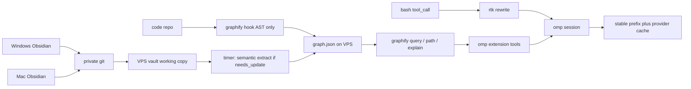

# Token optimisation for omp

Researched 2026-10-15 against host `omp v18.11.0`. Empty repo; this is the design note, not an implementation.

Decision: do not build a second compressor, and do not run Obsidian on the VPS. The plugin is a thin orchestrator over three things omp does not already do: RTK on bash output, a scoped Graphify query tool, and a git-synced markdown vault the agent reads as files. Provider prompt cache, snapcompact, hashline edits, and `memory.backend` stay native.

## How the pieces connect

Obsidian is a GUI over a folder of markdown. The agent never needs that GUI. Windows and Mac open the human vault in Obsidian. The VPS holds a plain git working copy of the same folder and reads it with `read` / Graphify. No Electron, no xvfb.



Two trees, two writers:

| Tree | Writer | Transport | Agent use |
| --- | --- | --- | --- |
| Human vault | People, via Obsidian | git pull/rebase on a timer. Stop on conflict. | Read notes. Do not let Graphify rewrite them. |
| `graphify-out/` | VPS only | gitignored in the code repo. Optional one-way publish if humans want to browse `graph.html`. | Query via CLI. Never paste `graph.json`. |

Do not nest the generated graph in the human vault. Do not bidirectional-sync it. A regenerating writer plus two GUIs produces conflict copies and a useless git history.

## What omp v18 already does

Do not reimplement these. Confirmed in the installed `@oh-my-pi/*` packages under `~/.omp/plugins` and in [docs/extensions.md](https://github.com/can1357/oh-my-pi/blob/main/docs/extensions.md) / [docs/memory.md](https://github.com/can1357/oh-my-pi/blob/main/docs/memory.md). Main is 383 commits ahead of the v18.11.0 tag; event names below were checked against that tag's types, prose is from main.

| Native | What it saves | Plugin rule |
| --- | --- | --- |
| Hashline edits | Output tokens on edits. Anchors, not full-file replacements. | Leave on. |
| Snapcompact | Discarded history rendered to local PNG frames. No LLM call. `compaction.methodOrder` replaces the old `compaction.strategy`. | Prefer `[remote, snap]` or snap where the reader is vision-capable. Do not also LLM-summarize the same span. |
| Tool-result caps / superseded-read prune | Input. Prune only when the suffix is small or the cache is cold. | Do not add a second truncator on the same result. |
| `cache_warming_decision` | Keeps the provider prefix warm. Main loop only. | A replacement payload on a warm replay must be byte-identical or the refresh misses. |
| `before_provider_request` | Can replace the outbound payload. Return the payload itself, not `{ payload }`. | Do not rewrite the stable prefix. `devin-agent` does not fire this hook. |
| `context` | May return `{ messages }` without rewriting persisted history. | Same rule: do not mutate the prefix. |
| `tool_call` / `tool_result` | Revise bash input, or patch result content. | This is the RTK hook. One owner only. |
| TTSR | Injects a matched rule mid-stream instead of parking it in the prompt. | Prefer this over a long always-on rules blob. |
| Model roles | Cheap model for consolidation, titles, extraction. | Set an explicit effort on every role. This host already routes `default` to grok-4.7. |
| `extendedContext` | Clamps premium long-context pricing. This host has it `true`. | Leave off unless a turn actually needs the premium window. |
| `memory.backend` | `off` (default), `local`, `hindsight`, `mnemopi`, `sharpshooter`. | Pick one. Do not add Engram or a fourth store. |
| `ctx.compact` | `soft` / `remote` / `snapcompact`. | Call it; do not write a parallel summarizer. |

`memory.backend: local` injects a capped summary at session start and does not mutate the live prefix when `learn` fires (this host has `autolearn.enabled: true`). Hindsight recalls into the first turn and then replays that recall from the session file so resume does not recall again. Mnemopi is the local SQLite backend (`memory://<id>`). Sharpshooter is friction-gated project decision files. All of these are session memory, not a codebase graph. Graphify does not replace them.

A `before_provider_request` shrink can make the provider report a small prompt and suppress auto-compaction. omp floors that with `compactionContextTokens`. A compressor must not assume it can hide history size.

## RTK

Repo: [rtk-ai/rtk](https://github.com/rtk-ai/rtk). Observed release v1.0.1 (2026-10-14). Not Redux Toolkit. Not Rust Type Kit (`reachingforthejack/rtk`). `cargo install rtk` from crates.io can install the wrong binary. Check with `rtk gain`.

What it does: rewrites a shell command to `rtk <cmd>` before execution, then filters stdout (grouping, truncation, dedup). Official omp install:

```bash
rtk init -g --agent omp    # ~/.omp/agent/extensions/rtk.ts
rtk init --agent omp       # ./.omp/extensions/rtk.ts
```

The extension is the same TypeScript file as Pi. On `tool_call` for `bash` it runs `rtk rewrite <cmd>` (2s timeout) and mutates `event.input.command`. Fail-open. Skips commands already starting with `rtk ` and `RTK_DISABLED=1`. Named omp profiles and a custom `PI_CONFIG_DIR` are not auto-detected.

Limits, from the README and the JetBrains 2026-07 trial of an earlier build:

- Hook fires only on the shell tool. `read`, `grep`, `glob` bypass it. Use `rtk read` / `rtk grep` / `rtk find` explicitly if those paths matter.
- Savings are bash-byte cuts, estimated as bytes/4. They are not bill cuts. Cached re-reads dominate input cost and are already discounted. A 60–90% bash shrink does not become a 60–90% invoice shrink. Extra turns from over-compression can raise cache-read volume.
- It does not break the provider prefix cache: the filtered result is written once into history and not rewritten later. Smaller results make the later cache read cheaper.
- `rtk-proxy` is a separate BUSL-1.1 daemon. Verified launcher is `rtk claude`, not omp. Do not point omp at it and also run Headroom.
- Licence: `rtk` is Apache-2.0 + BUSL-1.1 (engine). `rtk-oss` is Apache-2.0 filters only. Production use is free; offering a derivative as a service is not. Do not vendor the engine into this plugin.

Plugin rule: depend on the official extension. Do not reimplement `rtk rewrite`.

## Graphify

Official repo is [Graphify-Labs/graphify](https://github.com/Graphify-Labs/graphify) (Apache-2.0). `safishamsi/graphify` redirects. PyPI package is `graphifyy` (two y's). Observed 0.9.91. Requires Python >= 3.10.

```bash
uv tool install "graphifyy[watch]"
graphify install --project
```

`graphify install` writes a skill and, on hook platforms, a nudge to query the graph instead of grepping. The documented omp hook is only `omp plugin install "$(graphify pi guard path)"` — a read/grep guard, not the graph builder. This plugin should register its own tools that shell out to the CLI.

Query, do not paste:

```bash
graphify query "what calls X" --budget 2000
graphify path "DigestAuth" "Response"
graphify explain "SwinTransformer"
```

Exit 0 answer, 3 ambiguous name, 4 no node. `GRAPH_REPORT.md` is for a human architecture skim, not for every turn.

Cache and autonomy:

- Code: tree-sitter, local, no API key. `graphify hook install` runs an AST rebuild on post-commit / post-checkout, detached, timeout default 600s. A query immediately after commit can still see the old graph.
- Docs, PDFs, images: semantic pass sends those bytes to a model. Watch mode only sets `graphify-out/needs_update`. It does not spend tokens. A timer should run the semantic update only when that flag exists.
- `graphify-out/cache/` is content-hashed. Commit the graph if the team wants it shared; do not commit `cache/`. Add `graphify-out/` to `.graphifyignore` if a vault sits inside the scanned tree, or the graph will re-ingest its own notes.
- Headless semantic extract does not use the omp session as the LLM. It needs an explicit backend (`--backend ollama` to stay on the box, or a configured API key). The skill path uses host subagents.

Obsidian export: older READMEs and v8 source expose `graphify export obsidian`. The public CLI reference checked on 2026-10-15 did not confirm that format. Treat generated notes as rebuildable. Confirm with `graphify export --help` on the installed version before depending on a vault export. Humans can browse `graph.html` with no Obsidian at all.

Token claims: 71.5x and "80% fewer tokens" are author or Cloud marketing. The published ratio compares stuffing a corpus against a budgeted subgraph query, and `benchmark.py` estimates words as `nodes * 50` when no count is passed. Real savings exist only when the agent queries a scoped subgraph instead of reading files. They vanish on a 6-file tree, on `--mode deep` builds (those spend tokens), and if the agent still greps.

Privacy: code stays local. Notes sent through a semantic backend leave the machine. Kimi/Moonshot routes to servers in China. Query-log default is documented two ways (on in the README, off in the docs site) and was not found in the v8 CLI source. Check the installed binary before assuming either.

## Obsidian on a VPS

The agent needs a directory of `.md` files and a conflict it can refuse. It does not need Obsidian.

| Option | Headless on VPS | Conflict | Use |
| --- | --- | --- | --- |
| Git + [obsidian-git](https://github.com/Vinzent03/obsidian-git) | Yes. Timer: `pull --rebase`, commit only agent edits, stop on markers. | Explicit. `git merge --abort` restores. | **Human vault. Default.** |
| [Syncthing](https://docs.syncthing.net/users/syncing.html) | Yes, as a daemon. | `*.sync-conflict-*` files. Last mtime wins. | One-way publish of a generated tree only. Send Only on the VPS, Receive Only on desktops. |
| [obsidian-headless](https://obsidian.md/help/sync/headless) | Yes. Open beta, needs a Sync subscription, Node 22+. | Markdown merge can duplicate text. | Only if already paying for Sync. VPS pull-only. Do not run desktop Sync on the same path. |
| LiveSync + [livesync-cli](https://github.com/vrtmrz/obsidian-livesync) | CLI can materialize files. CouchDB alone is not a markdown tree. | Merge when a shared base exists. | Not the boring path. Reported daemon bugs in older CLI tags; back up first. |
| remotely-save | No. Sync runs only while the Obsidian process is open. | Manual keep-newer. | Does not fit an agent. |
| NFS / SMB / sshfs as the vault | Server is headless; Obsidian does not support network drives. | Last writer wins. | Do not. |

Git history is plaintext. A private GitHub repo is not end-to-end encrypted. Self-host the remote if the vault is sensitive. Ignore `.obsidian/workspace.json`, cache, and plugin `data.json` (it holds credentials).

Do not run two sync products on the same folder.

## Other libraries

Use at most one tool-output compressor. Stacking RTK + Headroom + rtk-proxy + billion-context double-compresses and can bust the prefix.

| Library | Saves | Fit |
| --- | --- | --- |
| [headroomlabs-ai/headroom](https://github.com/headroomlabs-ai/headroom) (`headroom-ai`, Apache-2.0) | Input, lossy but reversible via `headroom_retrieve`. `headroom wrap omp` exists. Default cache mode forwards prior turns byte-faithfully. `--mode token` recompresses history and busts the prefix. | Only if RTK's bash-only coverage is not enough and Read/JSON output is the measured cost. Do not also patch `tool_result` in this plugin. |
| [microsoft/LLMLingua](https://github.com/microsoft/LLMLingua) 0.2.2 MIT | Input, by deleting tokens. LongLLMLingua can reorder context. | Do not run it on the stable prefix. Domain mismatch vs coding traces. Adds a local model and latency. |
| [GPTCache](https://github.com/zilliztech/GPTCache), Portkey, LiteLLM, Bifrost, vCache | Skip the provider call on a similar prompt. | Unsafe for multi-turn agent turns. A hit returns someone else's answer. Fine only for identical non-agent side calls, which this host barely has. |
| [tirth8205/code-review-graph](https://github.com/tirth8205/code-review-graph) | Local tree-sitter graph, MCP, blast radius. Code only. | Companion if review/diff context is the bottleneck. Second graph, second hook set. Do not also instruct the agent to prefer Graphify for the same question. |
| universal-ctags / tree-sitter outline | Exact structural sketch of one file. | Inject in the live zone only, never into the system prompt (it changes every edit and busts the cache). |
| Aider repo map | Ranked symbol map. | Same rule: regenerate per turn in the tail, or not at all. |
| Mem0, Letta, Hindsight | Agent memory, not code structure. | omp already has Hindsight, Mnemopi, local, sharpshooter. Do not add another. |
| [arkhan/omp-optimizer](https://github.com/arkhan/omp-optimizer) | Caveman/Ponytail prompts, its own RTK hook, Engram. | Do not fork. Always-on terse prompts cost input tokens. Engram duplicates `memory.backend`. Author reports no independent measurement. |
| [mtakaki/omp-scribe](https://github.com/mtakaki/omp-scribe) | Cheap model expands a compact plan IR. | Only if plan-file prose is the measured bottleneck. The published `/savings` numbers are not a benchmark. |
| billion-context / Kompact | History folding proxies. | omp compaction already covers this. billion-context's omp plugin is deprecated and its instructions add thousands of tokens even to title requests. |

## Autonomous cache, by layer

"Cache autonomously" is four different caches. Mixing them is how prefixes die.

1. Provider prefix cache. Tools, then system prompt, then stable docs, then history, then the user turn. Byte-identical. No timestamps, vault mtimes, or graph hashes in the prefix. omp already warms it. This plugin must not register or unregister tools mid-session (`setActiveTools` retries `before_agent_start` and changes the base).
2. Graphify content cache. Already autonomous for code via the git hook. Docs wait for `needs_update`, then a scheduled semantic pass with a token budget and a cheap or local backend. That pass is a cost, not a saving, until later queries avoid reading the notes.
3. Tool-output cache. RTK writes the filtered result into history once. Later turns re-read it from the provider cache. Do not recompress history.
4. Response cache. Do not add one for agent turns.

A stable one-line pointer is enough in `before_agent_start`: "code graph at graphify-out; call graph_query before reading files." The pointer text must not include a hash, a file count, or a timestamp. Freshness belongs in the tool result, which sits in the tail.

## Plugin shape

Extension, not a skill-only bundle. `package.json`:

```json
{
  "name": "omp-token-opt",
  "version": "0.1.0",
  "omp": { "extensions": ["./src/index.ts"] }
}
```

Install with `omp plugin link .` from this repo. A package without an `omp` or `pi` block installs and then does nothing.

`src/index.ts` factory, register only, no `sendMessage` during load:

- Tools `graph_query`, `graph_path`, `graph_explain`. Shell out to the Graphify CLI with a hard budget and the session abort signal. Return the CLI stdout, not `graph.json`.
- Command `/token-status`: reports whether `rtk` is on PATH, whether `graphify-out/graph.json` exists, whether `needs_update` is set, and the vault git status. No model call.
- `session_start`: check binaries. Notify if missing. Do not inject a prompt here.
- `before_agent_start`: append the stable one-line pointer only when the graph exists. Complete replacement if overriding `systemPrompt`; do not patch text the host will rebase.
- Do not handle `tool_call` for bash if `~/.omp/agent/extensions/rtk.ts` or `./.omp/extensions/rtk.ts` is present. Two rewriters race.
- Do not handle `tool_result` compression if Headroom's proxy is on.
- `session_shutdown`: clear timers. Use `ctx.setInterval` for any vault pull; a raw timer throw tears down the session.

Out of process, not in the extension:

- `graphify hook install` in each code repo.
- systemd timer: if `graphify-out/needs_update` exists, run semantic `graphify update` with a budget; then `graphify export` only if the installed CLI still has an obsidian target and a human asked to browse it.
- systemd timer: `git -C "$VAULT" pull --rebase`. Non-zero exit, including conflict markers, pages a human. The agent does not auto-resolve vault conflicts.

## What not to build

- An Obsidian binary or a headless Electron on the VPS.
- A bidirectional sync of `graphify-out/` into the human vault.
- A custom semantic cache of agent turns.
- A fork of omp-optimizer, omp-scribe, or RTK.
- Always-on "be terse" system prompts. They cost input on every turn, including turns that emit code.
- LLMLingua or a regenerating repo-map inside the system prompt.
- A second compaction strategy beside `compaction.methodOrder`.

## Open checks before coding

1. `graphify --version` and `graphify export --help` on this VPS. Obsidian export may have left the public CLI reference.
2. `rtk gain` after `rtk init -g --agent omp`, then one bash turn, to confirm the extension loaded (restart omp; `.ts` extensions load at startup).
3. Whether Read/Grep output, not bash, is the actual token sink. If it is, Headroom cache mode beats more RTK surface. Measure with `omp stats` before adding it.
4. Vault sensitivity. GitHub private vs a self-hosted remote.

## Sources

- https://github.com/can1357/oh-my-pi/blob/main/docs/extensions.md
- https://github.com/can1357/oh-my-pi/blob/main/docs/memory.md
- https://github.com/can1357/oh-my-pi/blob/main/docs/marketplace.md
- installed `@oh-my-pi/snapcompact` README and `@oh-my-pi/pi-agent-core` compaction comments
- https://github.com/rtk-ai/rtk/blob/develop/README.md
- https://www.rtk-ai.app/docs/resources/troubleshooting/
- https://github.com/Graphify-Labs/graphify
- https://docs.graphify.com/guides/incremental-updates.md
- https://obsidian.md/help/sync/headless
- https://github.com/Vinzent03/obsidian-git
- https://docs.syncthing.net/users/syncing.html
- https://github.com/headroomlabs-ai/headroom
- https://github.com/microsoft/LLMLingua
- https://github.com/tirth8205/code-review-graph
- https://github.com/arkhan/omp-optimizer
- https://github.com/mtakaki/omp-scribe
